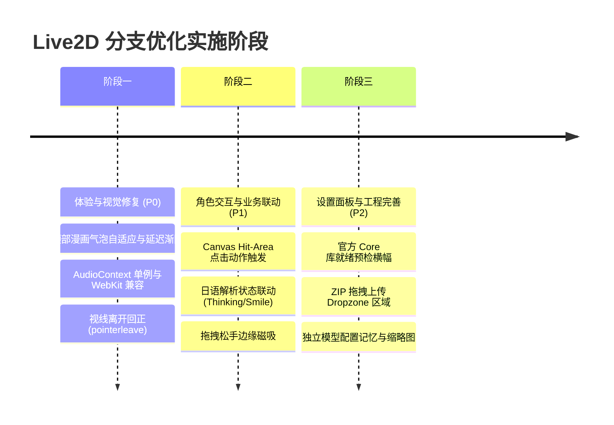

# 2026-10-12 Monday
## 今日任务清单
- [ ] 

## 过程记录


```

```

## 每日复盘
这两份优化建议的水平都非常高，且对当前基于 `untitled-pixi-live2d-engine`、Web Audio PCM 包络分析和 Next.js / React 19 的技术栈有着精准的洞察。

结合对当前仓库具体源码（[Live2DWidget.tsx](file:///Users/comet/WorkSpace/Project/Web/japanese-analyzer/app/plugins/live2d/Live2DWidget.tsx)、[Live2DCanvas.tsx](file:///Users/comet/WorkSpace/Project/Web/japanese-analyzer/app/plugins/live2d/Live2DCanvas.tsx)、[Live2DSettings.tsx](file:///Users/comet/WorkSpace/Project/Web/japanese-analyzer/app/plugins/live2d/Live2DSettings.tsx)、[audioEnvelope.ts](file:///Users/comet/WorkSpace/Project/Web/japanese-analyzer/app/plugins/live2d/audioEnvelope.ts) 以及 [globals.css](file:///Users/comet/WorkSpace/Project/Web/japanese-analyzer/app/globals.css)）的实际审视，我对两份建议进行横向对比分析，并给出一套**去粗取精、兼顾工程健壮性与伴学沉浸感**的统一代码优化方案。

---

### 一、 模型 A 与 模型 B 的对比与评估

| 评估维度 | 模型 A 的侧重与亮点 | 模型 B 的侧重与亮点 | 综合评价与采纳建议 |
| :--- | :--- | :--- | :--- |
| **角色伴学与业务融合** | **极高**：提出看板娘与**日语解析状态（AI 流式思考/成功/报错）**的情绪联动，让角色融入核心业务，而不是纯 TTS 喇叭。 | **未提及**：主要聚焦在 TTS 朗读与本地点击问候。 | **采纳 A 的设计**：作为日语语法解析器，将 AI 思考状态与动作系统挂钩，是该插件最大的产品差异化亮点。 |
| **底层性能与系统健壮性** | **中等**：提及了视线 Lerp 平滑插值。 | **极高**：精准指出 `audioEnvelope.ts` 在 Safari/WebKit 下反复 `new AudioContext` 会触发实例数量限制报错；指出切句防抖与头部防裁切。 | **采纳 B 的设计**：AudioContext 必须单例化复用；防裁切与视线离开屏幕回正（`pointerleave`）属于核心体验修复。 |
| **交互与视觉体验** | 强调挂件手柄隐形化、边缘吸附记忆、双指/滚轮快捷缩放。 | 强调收起态声波呼吸动效、长按任意位置拖拽、复位默认按钮、说话时身体微幅点头（ParamAngleY）。 | **融合互补**：顶部漫画气泡两家达成高度共识；采用“悬停显示微缩工具栏 + 边缘吸附 + 说话微动”最佳组合。 |
| **导入与设置面板 UX** | 提出内置预设模型（如 Hiyori）、解压提取缩略图、独立模型配置。 | 提出**官方 Cubism Core 就绪检测**、ZIP 拖拽上传区（Dropzone）、列表元数据展示。 | **融合互补**：B 的 Core 预检能直接解决新用户无从排错的痛点；结合拖拽上传与模型缩略图，大幅提高管理易用性。 |

---

### 二、 综合代码优化方案架构

将上述优势整合为 **四大核心模块**：

```mermaid
flowchart TD
    subgraph M1["模块 1：沉浸式视觉与交互"]
        A1[漫画式顶部自适应气泡] --> A2[边缘贴边吸附与平滑阻尼]
        A2 --> A3[全域拖拽 / 悬停淡入把手]
    end

    subgraph M2["模块 2：角色生命力与双向联动"]
        B1[HitArea 点击与表情动作触发] --> B2[AI 语法分析状态情绪联动<br/>Thinking / Success / Idle]
        B2 --> B3[TTS 说话韵律微动与眼球平滑回正]
    end

    subgraph M3["模块 3：底层性能与 WebKit 兼容"]
        C1[AudioContext 解码单例与复用] --> C2[视线跟踪 pointerleave 优雅回中]
        C2 --> C3[模型包围盒顶部 Safe Padding 防截头]
    end

    subgraph M4["模块 4：设置与模型资产工程化"]
        D1[Cubism Core 官方库就绪检测] --> D2[ZIP 拖拽释放 Dropzone]
        D2 --> D3[模型配置按模型独立记忆 / 缩略图]
    end
```



---

### 三、 核心模块的具体改造与代码实现

#### 1. 漫画式自适应对话气泡（替换底部单行裁切）

当前在 [Live2DWidget.tsx](file:///Users/comet/WorkSpace/Project/Web/japanese-analyzer/app/plugins/live2d/Live2DWidget.tsx#L388) 中，字幕是单行溢出省略（`ellipsis`），放在整个挂件底部遮挡角色。

**优化方案**：
- 将气泡移到挂件顶部/角色头部上方，采用漫画对话气泡样式（带朝下的小角标）。
- 结合播放状态增加 1.5 秒延迟淡出逻辑。

**改造步骤**：
在 [Live2DWidget.tsx](file:///Users/comet/WorkSpace/Project/Web/japanese-analyzer/app/plugins/live2d/Live2DWidget.tsx) 中增加字幕延时渐隐管理：

```tsx
// Live2DWidget.tsx
const [caption, setCaption] = useState<{ text: string; visible: boolean }>({ text: '', visible: false });
const captionTimerRef = useRef<number | null>(null);

useEffect(() => {
  if (speech?.status === 'playing' && speech.text) {
    if (captionTimerRef.current) window.clearTimeout(captionTimerRef.current);
    setCaption({ text: speech.text, visible: true });
  } else if (caption.visible) {
    // 朗读结束后保持 1.5 秒再渐隐
    captionTimerRef.current = window.setTimeout(() => {
      setCaption((prev) => ({ ...prev, visible: false }));
    }, 1500);
  }
  return () => {
    if (captionTimerRef.current) window.clearTimeout(captionTimerRef.current);
  };
}, [speech?.status, speech?.text]);
```

配合全局样式升级（在 [app/globals.css](file:///Users/comet/WorkSpace/Project/Web/japanese-analyzer/app/globals.css#L4180)）：

```css
/* 顶部漫画风对话气泡 */
.live2d-widget-bubble {
  position: absolute;
  top: -12px;
  left: 50%;
  transform: translate(-50%, -100%) scale(0.95);
  max-width: 240px;
  width: max-content;
  max-height: 110px;
  padding: 8px 12px;
  border: 1px solid var(--line);
  border-radius: 14px;
  background: color-mix(in srgb, var(--bg-2) 92%, transparent);
  box-shadow: 0 8px 24px -6px rgba(0, 0, 0, 0.18);
  backdrop-filter: blur(14px);
  -webkit-backdrop-filter: blur(14px);
  color: var(--ink);
  font-size: 12px;
  line-height: 1.5;
  word-break: break-word;
  opacity: 0;
  pointer-events: none;
  transition: opacity 0.25s cubic-bezier(0.16, 1, 0.3, 1),
              transform 0.25s cubic-bezier(0.16, 1, 0.3, 1);
  z-index: 10;
}

.live2d-widget-bubble.is-visible {
  opacity: 1;
  transform: translate(-50%, -100%) scale(1);
  pointer-events: auto;
}

/* 气泡小尾巴 */
.live2d-widget-bubble::after {
  content: '';
  position: absolute;
  bottom: -6px;
  left: 50%;
  transform: translateX(-50%);
  width: 0;
  height: 0;
  border-left: 6px solid transparent;
  border-right: 6px solid transparent;
  border-top: 6px solid color-mix(in srgb, var(--bg-2) 92%, transparent);
}
```

---

#### 2. 点击交互反馈与闲置待机动作 (Hit-Test & Idle Loop)

当前在 [Live2DCanvas.tsx](file:///Users/comet/WorkSpace/Project/Web/japanese-analyzer/app/plugins/live2d/Live2DCanvas.tsx#L202) 中传了 `autoHitTest: false`，且外层 `.live2d-widget-body` 设置了 `pointer-events: none`。

**优化方案**：
1. 在 [Live2DCanvas.tsx](file:///Users/comet/WorkSpace/Project/Web/japanese-analyzer/app/plugins/live2d/Live2DCanvas.tsx) 中暴露触控处理能力：
   ```tsx
   // 开启并监听模型的 hitTest
   nextModel.on('hit', (hitAreas: string[]) => {
     if (hitAreas.includes('Head') || hitAreas.includes('head')) {
       void nextModel.motion('TapHead') || nextModel.expression('smile');
     } else {
       void nextModel.motion('Tap') || nextModel.motion('TapBody');
     }
   });
   ```
2. 在 [Live2DWidget.tsx](file:///Users/comet/WorkSpace/Project/Web/japanese-analyzer/app/plugins/live2d/Live2DWidget.tsx) 中增加对 `.live2d-widget-canvas` 的点击转发。当用户点击立绘时，触发一次可爱的动作或气泡问候（如「一緒に勉強しましょう！」）。
3. 增加 Idle 定时器：在无操作和无朗读时，每 20~30 秒随机调用一次待机微表情。

---

#### 3. 业务联动：AI 解析生命周期与表情状态同步

这是让看板娘成为真正“伴学角色”的关键一步。当前应用在进行日语句子解析时，状态流经 `loading / analyzing / success / error`。

**设计方案**：
通过自定义事件或现有的事件通道，让 `Live2DWidget` 感知主页面分析状态：

```tsx
// Live2DWidget.tsx
useEffect(() => {
  const handleAnalysisEvent = (event: CustomEvent<{ state: 'analyzing' | 'success' | 'error' }>) => {
    if (!settings.enabled || docked) return;
    switch (event.detail.state) {
      case 'analyzing':
        // AI 思考中：微仰头/思考表情
        void canvasRef.current?.setExpression?.('thinking');
        break;
      case 'success':
        // 分析成功：开心微笑或轻微点头
        void canvasRef.current?.setExpression?.('smile');
        void canvasRef.current?.playMotion?.('Smile');
        break;
      case 'error':
        // 报错或断网：困惑表情
        void canvasRef.current?.setExpression?.('confused');
        break;
    }
  };

  window.addEventListener('app:analysis-state' as any, handleAnalysisEvent);
  return () => window.removeEventListener('app:analysis-state' as any, handleAnalysisEvent);
}, [settings.enabled, docked]);
```

---

#### 4. WebKit / Safari 友好：AudioContext 惰性单例化

在 [audioEnvelope.ts](file:///Users/comet/WorkSpace/Project/Web/japanese-analyzer/app/plugins/live2d/audioEnvelope.ts#L67-L77) 中，每次调用均新建并关闭一个 `AudioContext`：

```typescript
// 现有问题代码：
const context = new AudioContextClass();
try { ... } finally { await context.close(); }
```
在 Safari 和 iOS 上连续点读多句话时，快速创建和销毁 AudioContext 会触发 `QuotaExceededError` 或无声卡死。

**优化方案**（复用共享解码上下文）：

```typescript
// audioEnvelope.ts
let sharedAudioContext: AudioContext | null = null;

function getSharedContext(): AudioContext {
  if (typeof window === 'undefined') throw new Error('Audio decoding requires a browser');
  if (!sharedAudioContext || sharedAudioContext.state === 'closed') {
    const AudioContextClass = window.AudioContext ||
      (window as Window & { webkitAudioContext?: typeof AudioContext }).webkitAudioContext;
    if (!AudioContextClass) throw new Error('Web Audio is unavailable');
    sharedAudioContext = new AudioContextClass();
  }
  return sharedAudioContext;
}

export function getSpeechEnvelope(blob: Blob): Promise<SpeechEnvelope> {
  const existing = cachedEnvelopes.get(blob);
  if (existing) return existing;

  const task = (async () => {
    const context = getSharedContext();
    // decodeAudioData 会消耗 ArrayBuffer，因此先切片或复制
    const buffer = await context.decodeAudioData(await blob.arrayBuffer());
    const channels = Array.from({ length: buffer.numberOfChannels }, (_, i) => buffer.getChannelData(i));
    return createSpeechEnvelope(channels, buffer.sampleRate);
  })();

  cachedEnvelopes.set(blob, task);
  void task.catch(() => cachedEnvelopes.delete(blob));
  return task;
}
```

---

#### 5. 拖拽边缘磁吸（Snap to Edge）与视线离开回正

在 [Live2DWidget.tsx](file:///Users/comet/WorkSpace/Project/Web/japanese-analyzer/app/plugins/live2d/Live2DWidget.tsx#L236) 的 `finishDrag` 中，增加左右边界磁吸判定：

```tsx
// Live2DWidget.tsx
const finishDrag = (event: PointerEvent<HTMLButtonElement>) => {
  const drag = dragRef.current;
  const widget = widgetRef.current;
  if (!drag || !widget) return;

  const rect = widget.getBoundingClientRect();
  const threshold = 36;
  let finalX = rect.left;

  // 靠近左侧边缘 36px 内则磁吸贴紧左侧；靠近右侧则贴紧右侧
  if (rect.left < threshold) {
    finalX = 12;
  } else if (window.innerWidth - (rect.left + rect.width) < threshold) {
    finalX = window.innerWidth - rect.width - 12;
  }

  const snappedPos = clampPosition({ x: finalX, y: rect.top }, rect.width, rect.height);
  positionRef.current = snappedPos;
  setPosition(snappedPos);
  savePosition(drag.key, snappedPos);

  dragRef.current = null;
  setDragging(false);
};
```

在 [Live2DCanvas.tsx](file:///Users/comet/WorkSpace/Project/Web/japanese-analyzer/app/plugins/live2d/Live2DCanvas.tsx#L267) 中监听 `pointerleave` 实现视线平滑归中：

```tsx
// Live2DCanvas.tsx
const handleMouseLeave = () => {
  if (!app || !model) return;
  // 视线平滑回正到画布中心前上方
  model.focus(app.screen.width / 2, app.screen.height * 0.4);
};
document.addEventListener("pointerleave", handleMouseLeave);
// 清理时移除监听
```

---

#### 6. 设置面板：Cubism Core 运行环境预检与拖拽上传

在 [Live2DSettings.tsx](file:///Users/comet/WorkSpace/Project/Web/japanese-analyzer/app/plugins/live2d/Live2DSettings.tsx) 中增加对官方 SDK 脚本的自动预检和提示，极大降低新用户的排障门槛：

```tsx
// Live2DSettings.tsx
const [coreReady, setCoreReady] = useState<boolean | null>(null);

useEffect(() => {
  if (typeof window === 'undefined') return;
  if ((window as any).Live2DCubismCore) {
    setCoreReady(true);
    return;
  }
  fetch('/live2d/core/live2dcubismcore.min.js', { method: 'HEAD' })
    .then((res) => setCoreReady(res.ok))
    .catch(() => setCoreReady(false));
}, []);
```

在面板上方增加友好的提醒横幅：
```tsx
{coreReady === false && (
  <div className="live2d-core-alert">
    <span>⚠️</span>
    <p>
      {t('未检测到官方 Cubism 运行库。请将 live2dcubismcore.min.js 放置在 public/live2d/core/ 目录下。')}
    </p>
  </div>
)}
```

---

### 四、 推荐分步落地路线图

建议分 3 个阶段推进，保证每一步都有立竿见影的收益且不破坏现有分支稳定性：



1. **阶段一（即刻落地，低成本高收益）**：
   - 气泡从底部截断单行迁移为顶部自适应漫画气泡（CSS + 延时定时器）。
   - 单例化复用 `AudioContext`，彻底消除移动端/Safari 潜在音频崩溃隐患。
   - 补充 `pointerleave` 视线回中。

2. **阶段二（赋予灵魂）**：
   - 开启 Canvas 点击事件与基础表情动作响应。
   - 接入主应用的分析状态广播，让看板娘在用户查句时产生“陪伴思考”与“解析成功微笑”反馈。
   - 加入拖拽松手吸附边缘。

3. **阶段三（打磨细节）**：
   - 设置面板 Core 就绪预检、拖拽上传区域以及模型列表的精致化。


日语的拆词方法