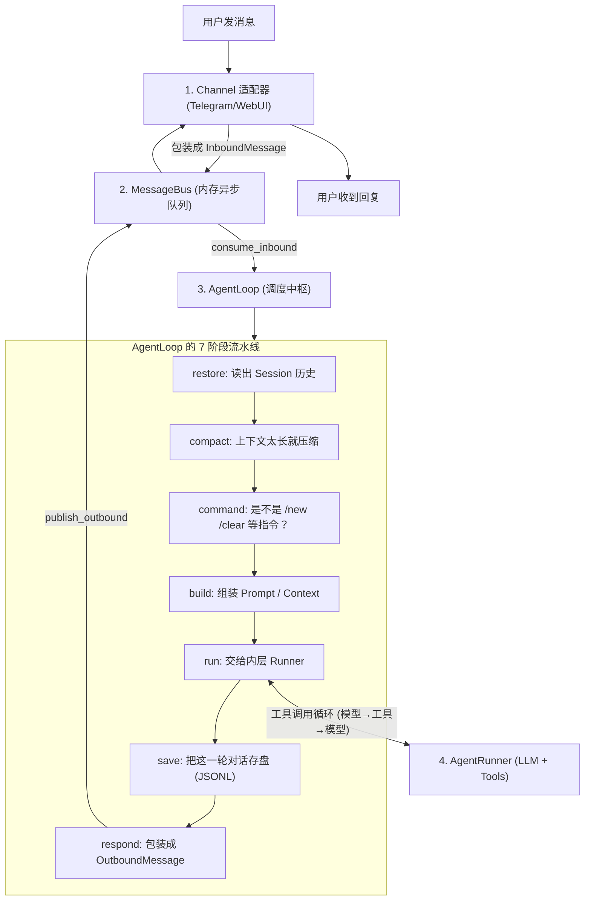
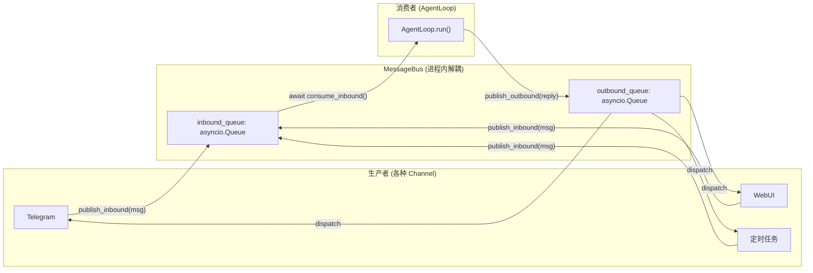
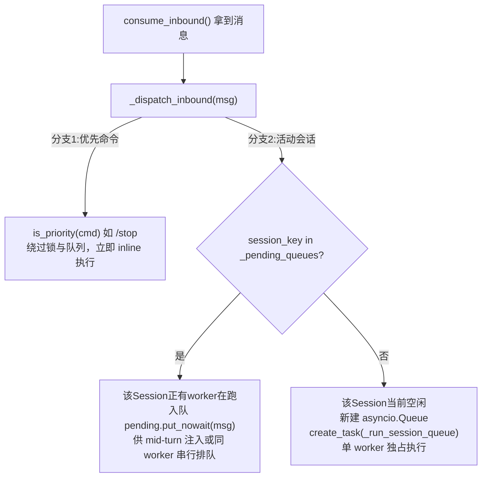

## TypeScript 系统学习路线

| 阶段  | 学习内容            | 细节                          |
| --- | --------------- | --------------------------- |
| 阶段一 | JavaScript 基础   | 掌握 JS 语法、对象、数组、函数、异步编程      |
| 阶段二 | TypeScript 核心语法 | 掌握类型、接口、泛型、类型收窄和类型工具        |
| 阶段三 | TypeScript 工程化  | 掌握模块、npm、tsconfig、类型声明和项目配置 |
| 阶段四 | TypeScript 实战项目 | 在真实项目中解决类型设计和业务逻辑问题         |

这次参加广州移动大会，我们组主要关注了移动推出的模型服务平台和芯片厂商摩尔线程，有两个心得，分别关注项目交付和算力选择。

**第一个是交付模式：我们能否借助中国移动这样的模型服务平台，能不能把更多精力放在产品和业务场景上，缩短项目交付链路。**

**第二个是算力选择：对于需要私有化部署、同时有信创要求的项目，我们能不能在现有方案之外，增加其他国产算力卡作为备选。**

下面，我从这两个方面，结合大会上了解到的信息，汇报一下自己的思考。

**先说第一个方面：与平台合作，可能改变我们的项目分工。**

本次大会了解到中国移动有推出 MoMA （Mobile Model Access ）移动模型服务平台。根据现场宣讲，可以得到两点比较重要的信息。

第一点是它采用多模型聚合的方式，汇聚国内多家厂商的大模型，同时也上线了机密模型服务。按照我目前了解到的信息，这部分服务目前以视频生成类模型为主。

二是它提出统一量纲的计费思路，尝试将语音、流量和 Token 纳入同一套计量体系，打通通信资源与 AI 算力资源的账单计算方式。

对我们来说，这两点的意义，不只是多了一个调用模型的渠道，而是有机会调整我们在项目中的角色。

过去做一个 AI 项目，我们往往需要同时考虑很多事情：前面要理解客户需求，中间要选硬件、部署服务器、搭建模型推理环境，后面还要开发应用、对接业务系统，再完成验收。

如果与中国移动合作，并且客户的数据和部署要求允许使用平台服务，那么算力和模型服务这部分，就有机会由合作方承接，我们把重心放在应用产品和业务流程上。

比如工业设备远程诊断，客户真正关心的是：设备异常能不能更早发现，故障原因能不能更快定位，维修人员能不能拿到有用的建议。

再比如厂区 AI 辅助工作台，客户关心的是：安全隐患能不能及时识别和告警，生产报表能不能自动汇总，发现问题以后能不能进入后续处理流程。

这些工作都离不开对现场业务的理解。哪些信息需要采集，哪些判断必须由人确认，结果交给谁处理，最终怎样验收，这些仍然需要我们来做好。

所以，我的第一个判断是：**如果基础模型和算力服务能够由合作平台提供，我们的竞争力就要更多体现在场景理解、系统集成和业务流程改造上。**

这种分工有机会减少我们在基础设施上的重复投入，缩短交付周期，也减少需要自己承担的部署和运维环节。统一计费的思路，则可能进一步简化客户采购和管理多类资源的过程。至于实际能节省多少成本，还需要结合具体套餐和项目用量来算。

像中储粮这样的案例，可以作为我们继续了解这类合作模式的参考。后续值得重点研究的是：平台提供了什么，应用厂商负责了什么，客户最终通过哪些业务指标判断项目有效。

这一点，我想总结为：**借助平台承接基础能力，让我们把更多精力投入到客户愿意付费的业务价值上。**

**再说第二个方面：需要自主承担私有化部署时，国产算力可以增加一个评估方向。**

这里需要区分一下：是否需要交付硬件，不能只看有没有和中国移动合作，主要还是看客户的部署要求，以及项目由谁负责基础设施。

如果客户要求模型在本地运行，并且需要我们承担整套交付，那么除了应用软件，我们还要考虑硬件选型、推理环境、模型适配和后续运维。

这次大会的 AI 芯片展区，有华为昇腾、昆仑芯、摩尔线程等多家国产算力厂商。我重点了解了摩尔线程的 MTT SGX5000 服务器。

结合我们过去的项目经验，在没有信创约束时，我们通常优先考虑英伟达 GPU；有明确的信创要求时，我们比较熟悉的方案主要是华为昇腾。

而这次现场了解到，摩尔线程已经完成了 Qwen3.8-27B 模型的适配。这给我的启发是，后续做有信创要求的私有化项目时，我们可以把它纳入候选方案，进一步评估。

当然，完成某个模型的适配，和能够满足我们实际项目的要求，中间还需要做验证。

比如，同一个模型在上面运行，响应速度和并发能力怎么样；我们现有的 Agent、RAG 应用接入起来是否顺畅；长时间运行是否稳定；再加上硬件采购、适配工作和维护投入，整体成本是否合适。

所以，我对这部分的结论是：**可以增加一个备选，但是否采用，要通过实际测试来决定。**

对我们而言，值得做的下一步，是选一个熟悉的模型和典型业务场景，在候选硬件上做一次验证。这样以后遇到类似项目，我们就能拿着测试结果做选型，而不是临时从头了解。

这一点，我想总结为：**逐步积累国产算力的适配和评估经验，让信创项目的选型更有依据。**

最后，回到开头的两个心得。

在能够使用平台服务的项目里，我们要考虑怎样通过合作缩短交付链路，把重点放在产品和业务效果上。

在需要自主承担私有化部署的项目里，我们要关注国产算力的发展，通过验证增加可用的选择。

这两点对应到我们公司的工作，就是：**应用层要更懂客户，部署方案要有更多经过验证的选择。**

以上就是我这次参会的主要思考，谢谢大家。