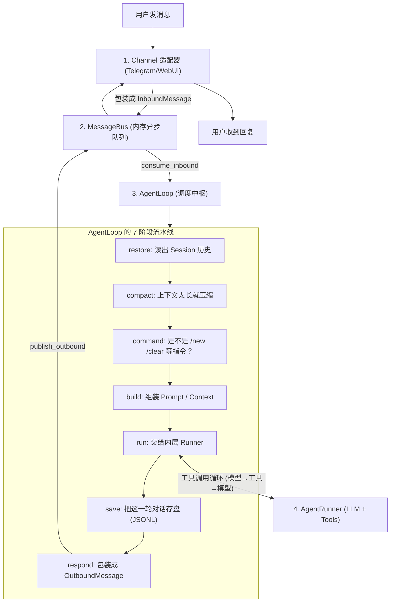
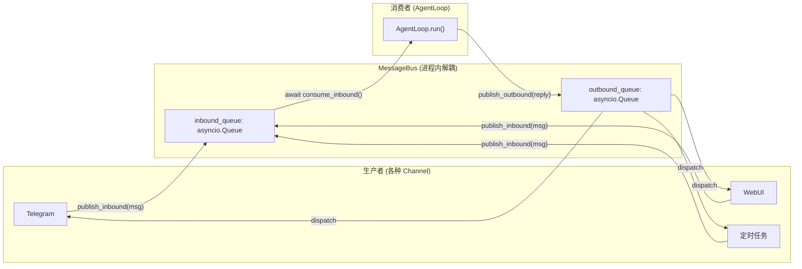
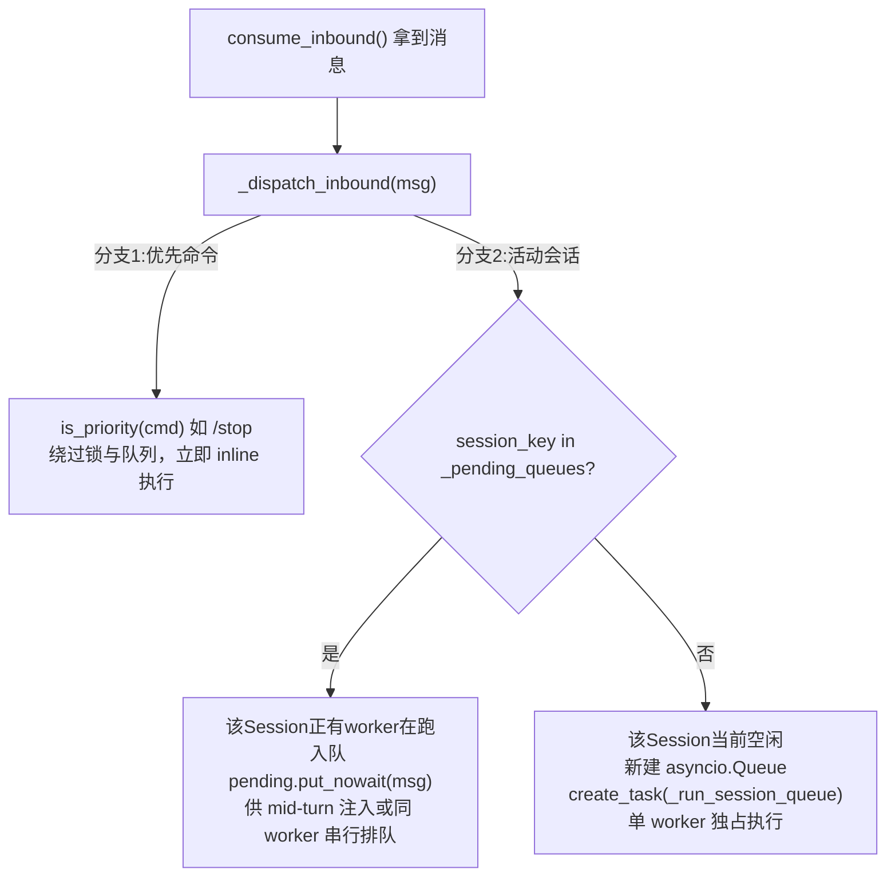
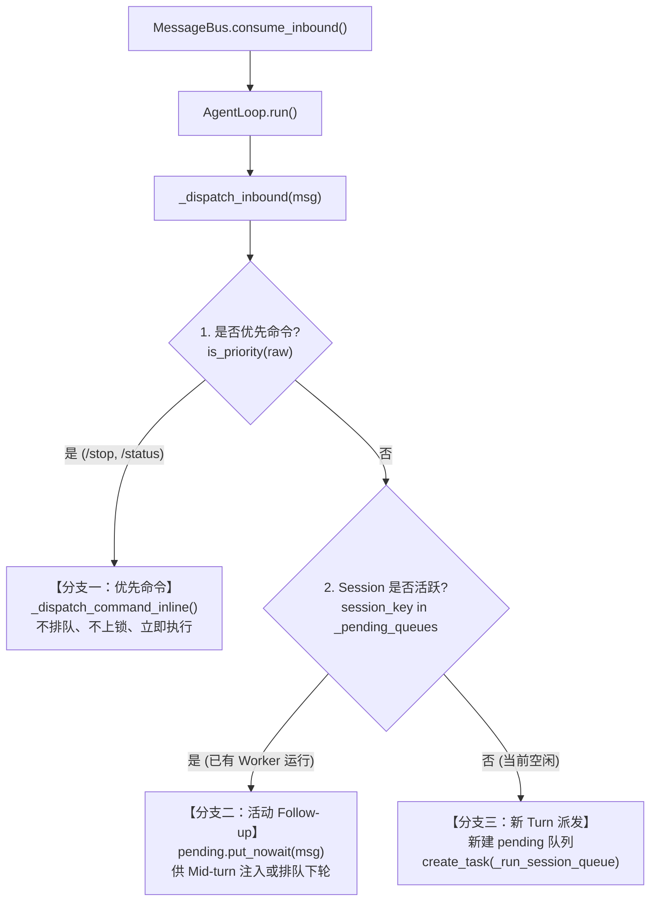

## TypeScript 系统学习路线

| 阶段  | 学习内容            | 细节                          |
| --- | --------------- | --------------------------- |
| 阶段一 | JavaScript 基础   | 掌握 JS 语法、对象、数组、函数、异步编程      |
| 阶段二 | TypeScript 核心语法 | 掌握类型、接口、泛型、类型收窄和类型工具        |
| 阶段三 | TypeScript 工程化  | 掌握模块、npm、tsconfig、类型声明和项目配置 |
| 阶段四 | TypeScript 实战项目 | 在真实项目中解决类型设计和业务逻辑问题         |

Name：SHOU_OceanBase

URL：mysql://root@shou@192.168.3.166:2881/shou_vector_dev?characterEncoding=utf8

Host：192.168.3.166

Port：2881

Database：shou_vector_dev

User：root@shou

Type：OceanBase

Server version：v5.7.25-OceanBase_CE-v4.5.0.0

排查ETL爬虫问题