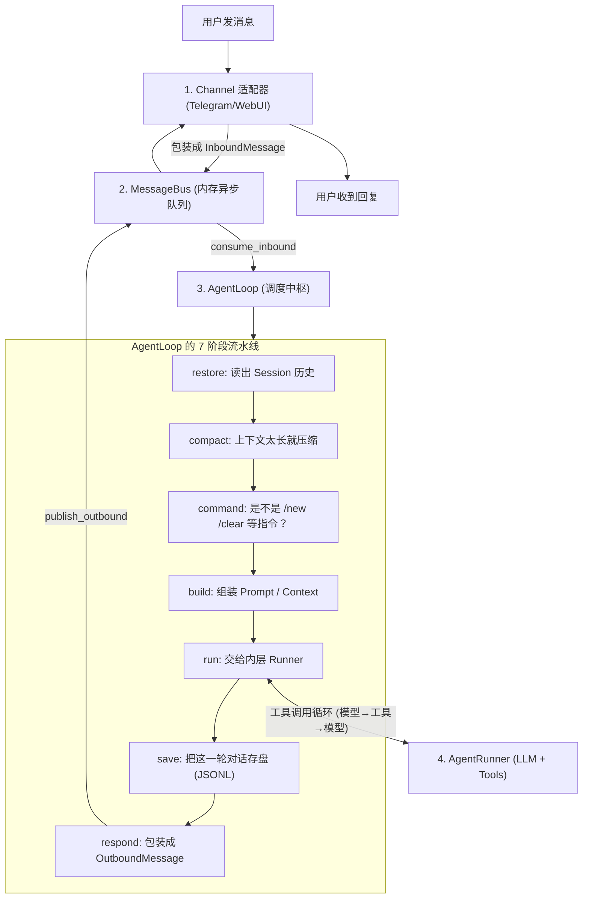
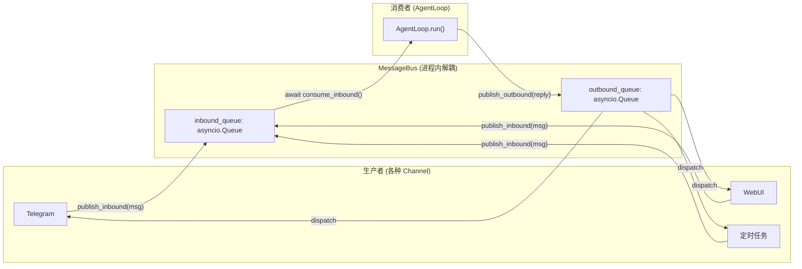
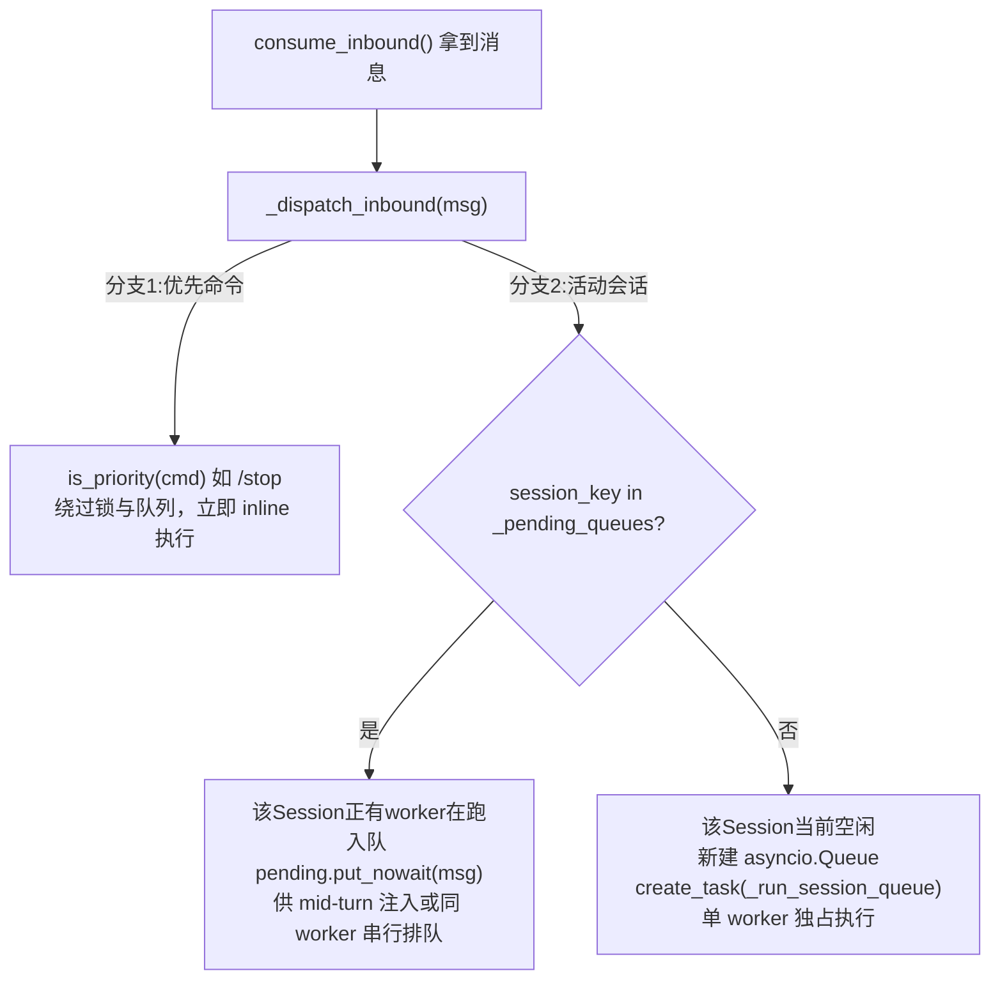
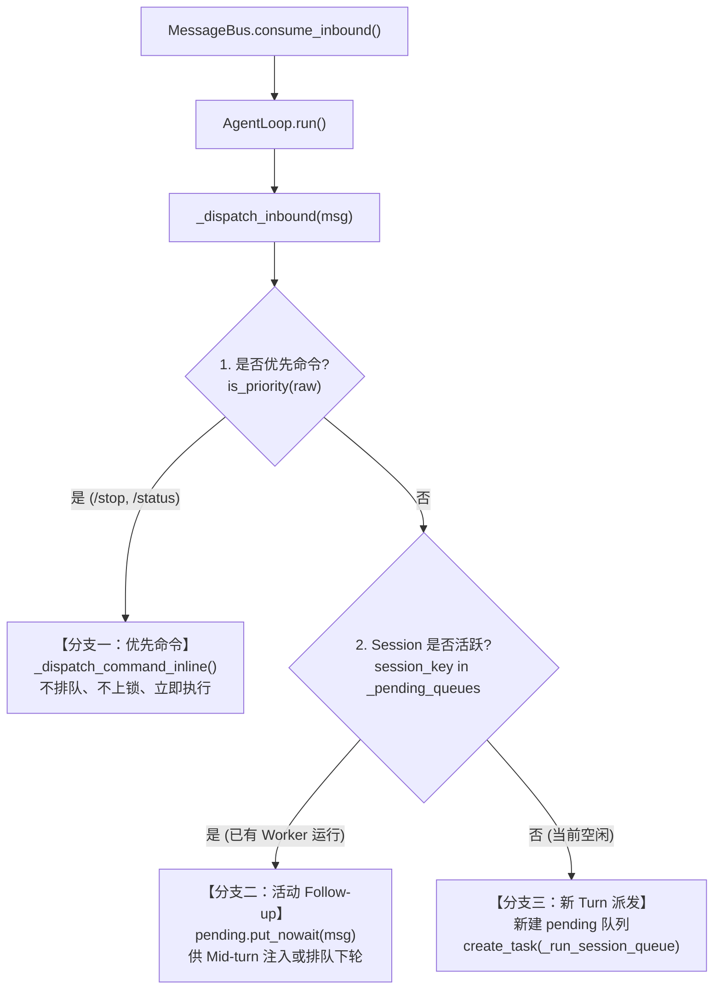

## TypeScript 系统学习路线

| 阶段  | 学习内容            | 细节                          |
| --- | --------------- | --------------------------- |
| 阶段一 | JavaScript 基础   | 掌握 JS 语法、对象、数组、函数、异步编程      |
| 阶段二 | TypeScript 核心语法 | 掌握类型、接口、泛型、类型收窄和类型工具        |
| 阶段三 | TypeScript 工程化  | 掌握模块、npm、tsconfig、类型声明和项目配置 |
| 阶段四 | TypeScript 实战项目 | 在真实项目中解决类型设计和业务逻辑问题         |

1. 排查ETL爬虫问题（文件超时导致）
2. 编写模型迁移文档
3. 修复Document Chat的PR https://github.com/steins-tech/shou-confer-platform/pull/1785

## **一 现有模型与配置**

|   |   |   |
|---|---|---|
|服务|当前模型与规模|当前部署的模型配置|
|LLM / VLM|Qwen/Qwen3.8-27B   参数规模 27B|上下文 256K tokens；   开启思考。   输入：文本、图像；   输出：文本。|
|Embedding|Qwen/Qwen3-VL-Embedding-8B   参数规模 8B|最大序列长度 40,960 tokens。   业务向量 4,096 维。   输入：文本、图像；   输出：向量。|
|Reranker|Qwen/Qwen3-VL-Reranker-8B   参数规模 8B|最大序列长度 40,960 tokens。   当前检索路径使用文本，客户端支持图像。   业务返回：候选索引、相关性分数。|
|文档解析|opendatalab/   MinerU2.5-Pro-2605-1.2B   参数规模 1.2B|最大序列长度 8,192 tokens。|
|ASR|Qwen/Qwen3-ASR-1.7B   参数规模 1.7B|最大序列长度 8,192 tokens；   中文 zh。   业务音频：PCM S16LE、16 kHz、单声道。   输出：转写文本。|
|安全审核|Qwen/Qwen3Guard-Gen-8B   参数规模 8B|最大序列长度 32,768 tokens。   等级：Safe、Unsafe、Controversial。   业务字段：Safety、Categories。   temperature=0；   max_tokens=128。|

  

## **二 此前与校方沟通的信息与本次待确认信息**

|   |   |   |
|---|---|---|
|服务|此前沟通信息|请校方本次明确|
|LLM / VLM|DeepSeek 系列，具体型号未定。   曾沟通上下文 128K。|完整模型 ID 与版本；准确上下文及输出上限；思考模式及开关；图像输入是否可用。|
|Embedding|Qwen3-VL-Embedding-8B   曾沟通 8K。|实际序列长度；能否返回 4,096 维；文本和图像输入方式；批量大小；版本与预处理配置。|
|Reranker|Qwen3-VL-Reranker-8B   曾沟通 8K。|每个查询与候选组合的长度限制；候选数量上限；批量调用；索引与分数的返回格式；图像能力范围。|
|文档解析|MinerU2.5-Pro-2605-1.2B   曾沟通 8K。|8K 对应的处理环节和统计口径；文件、页数限制；文件提交接口；解析产物示例与支持范围。|
|ASR|Qwen3-ASR-1.7B   曾反馈后续可接入，8K。|本次能否提供及何时测试；型号与版本；中文与现有音频格式的接入方式；时长限制及转写结果格式。|
|安全审核|Qwen3Guard-Gen-8B   曾沟通 8K。|是否为 Gen 型；上下文限制；原始响应示例；Safety 和 Categories 的提取或适配方式；调用参数支持情况。|

  

## 三 问题清单

### **问题1：六类服务分别能否提供**

对话模型： LLM / VLM Deepseek模型（需要明确具体型号，版本）：
- [ ] 可以
- [ ] 不可以

图文向量化模型 Qwen/Qwen3-VL-Embedding-8B：
- [ ] 可以
- [ ] 不可以

检索结果重排模型 Qwen/Qwen3-VL-Reranker-8B：
- [ ] 可以
- [ ] 不可以

文档解析模型 opendatalab/MinerU2.5-Pro-2605-1.2B：
- [ ] 可以
- [ ] 不可以

语音转文字模型 Qwen/Qwen3-ASR-1.7B：
- [ ] 可以
- [ ] 不可以

内容安全审核模型 Qwen/Qwen3Guard-Gen-8B：
- [ ] 可以
- [ ] 不可以

### 问题2：每类服务的配置

|           |                                                                                                                                |        |
| --------- | ------------------------------------------------------------------------------------------------------------------------------ | ------ |
| 服务        | 我方现有配置                                                                                                                         | 校方本次配置 |
| LLM / VLM | 上下文 256K tokens；   开启思考。   输入：文本、图像；   输出：文本。                                                                         |        |
| Embedding | 最大序列长度 40,960 tokens。   业务向量 4,096 维。   输入：文本、图像；   输出：向量。                                                            |        |
| Reranker  | 最大序列长度 40,960 tokens。   当前检索路径使用文本，客户端支持图像。   业务返回：候选索引、相关性分数。                                                           |        |
| 文档解析      | 最大序列长度 8,192 tokens。                                                                                                           |        |
| ASR       | 最大序列长度 8,192 tokens；   中文 zh。   业务音频：PCM S16LE、16 kHz、单声道。   输出：转写文本。                                                 |        |
| 安全审核 Gen  | 最大序列长度 32,768 tokens。   等级：Safe、Unsafe、Controversial。   业务字段：Safety、Categories。   temperature=0；   max_tokens=128。 |        |
