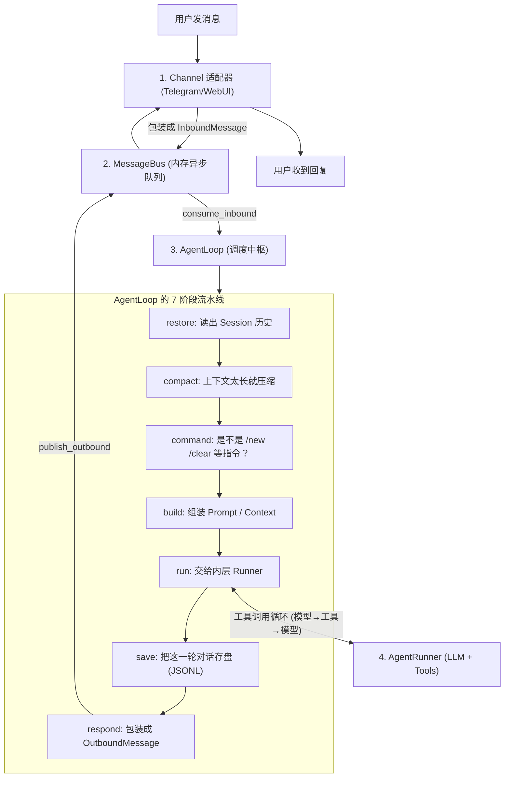
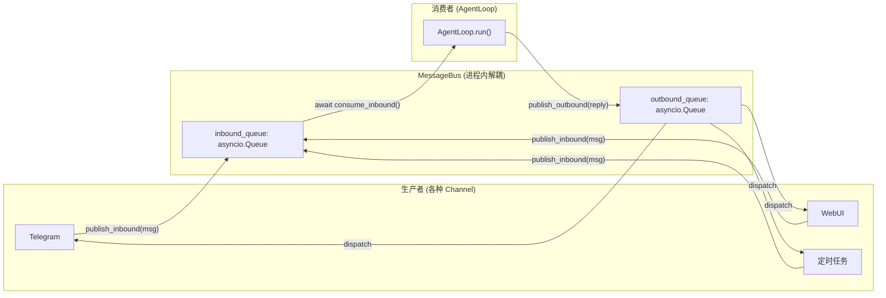
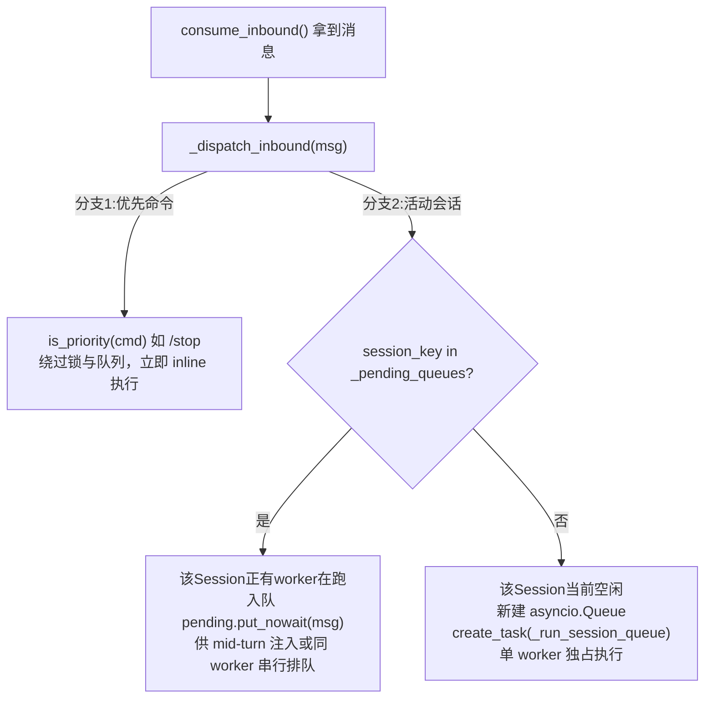

## TypeScript 系统学习路线

| 阶段  | 学习内容            | 细节                          |
| --- | --------------- | --------------------------- |
| 阶段一 | JavaScript 基础   | 掌握 JS 语法、对象、数组、函数、异步编程      |
| 阶段二 | TypeScript 核心语法 | 掌握类型、接口、泛型、类型收窄和类型工具        |
| 阶段三 | TypeScript 工程化  | 掌握模块、npm、tsconfig、类型声明和项目配置 |
| 阶段四 | TypeScript 实战项目 | 在真实项目中解决类型设计和业务逻辑问题         |

本次广州移动大会，我们2组有两点心得，对应我们对接央国企的两类合作路径：一是依托移动 MoMA 平台联合交付；二是独立私有化项目的信创算力选型。

第一，中国移动新发布的 MoMA 移动模型服务平台，有两个亮点：多模型聚合，支持机密模型服务；创新统一量纲计费，打通流量、语音、Token 算力账单。 如果我们和移动合作，我们定位场景服务商，专注业务场景、流程改造，比如厂区 AI 工作台、设备远程诊断、隐患识别、报表自动化。算力底座、服务器部署这些都由移动承接，交付更轻、成本和风险更低，中储粮就是很好的参考案例。

第二，在算力展区，我重点关注到摩尔线程 MTT SGX5000 服务器，已经适配 Qwen3.8-27B。 如果项目不跟移动合作、走私有化部署，我们就要配套算力方案。之前信创项目大多只用昇腾，现在我们多了一个可评估的备选显卡，丰富我们信创算力方案。

总结：和移动合作，我们聚焦上层应用，轻资产落地；独立私有化项目，我们扩充信创算力选型，方案更灵活。后续对接项目，可以按这个思路匹配方案。